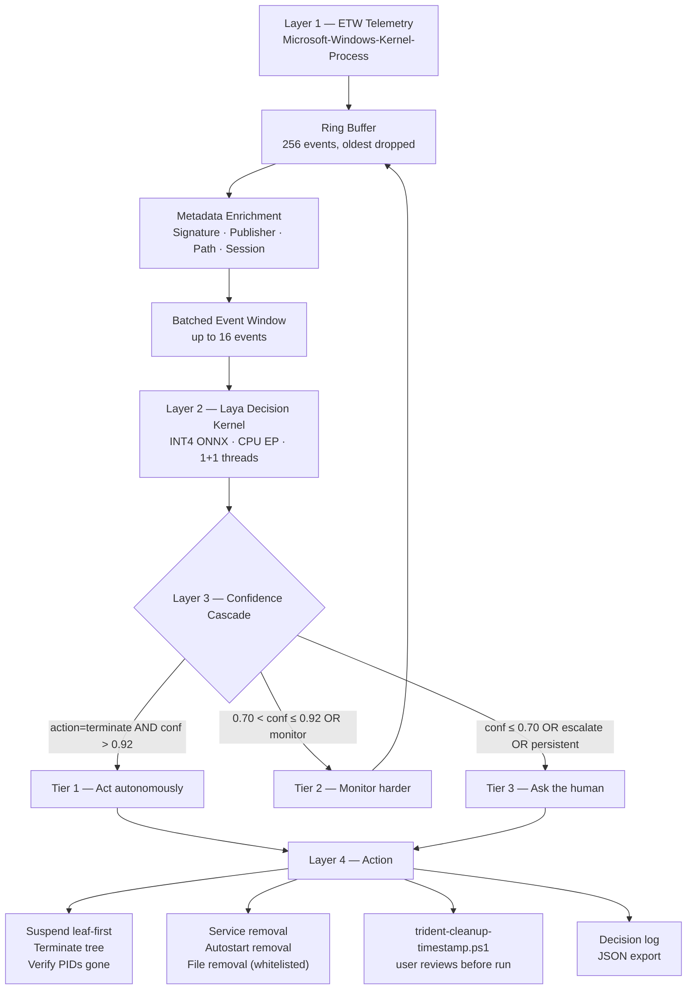
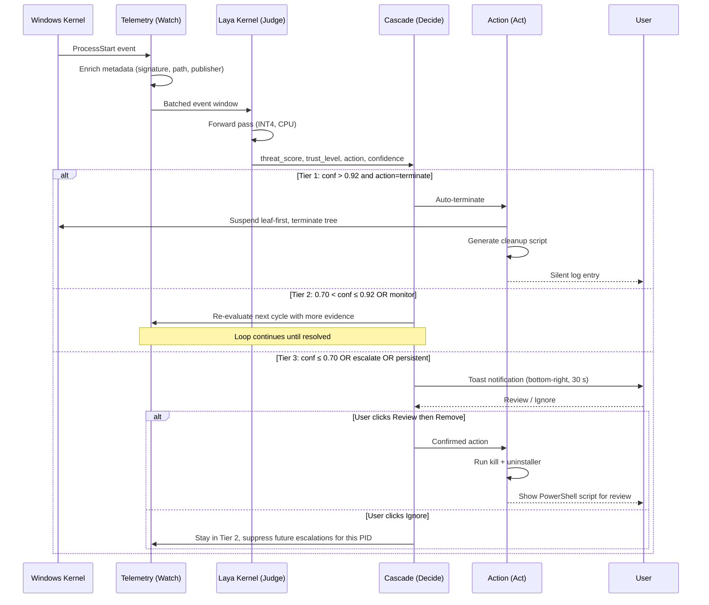

<div align="center">

<svg width="88" height="150" viewBox="0 0 88 150" fill="none" xmlns="http://www.w3.org/2000/svg" role="img" aria-label="TRIDENT">
  <g stroke="#0E6E6E" stroke-width="5.5" stroke-linecap="round">
    <path d="M22 86 V38"/>
    <path d="M44 86 V20"/>
    <path d="M66 86 V38"/>
    <path d="M10 100 H78"/>
    <path d="M44 100 V148"/>
  </g>
</svg>

# TRIDENT

### The immune layer for Windows.

**Watch. Judge. Act.**

*A local, event-driven, AI-powered system immune layer that stays quiet until it matters.*

<br/>

[](#)


[](#)
[](#)
[](#)
[](#)
[](#)
[](#)
[](#)

</div>

---

> **TRIDENT is the quiet immune layer that watches Windows processes, judges them with a local AI model, and acts only when it is sure.**

A Windows machine accumulates background processes: legitimate updaters, badly written services, adware, coin miners, malware. Task Manager shows names and CPU percentages, but no judgment. Signature-based antivirus misses novel behavior. Cloud EDR is expensive, invasive, and needs a network connection.

TRIDENT runs entirely on the local machine. It watches process behavior via ETW, asks a quantized open-source language model three typed questions about each process, and acts only when its calibrated confidence clears a threshold. Otherwise it stays quiet.

**Zero network. Zero signatures. Zero kernel drivers. Under 500 MB RAM. Under 150 ms per decision. Runs even on a 2018 i3.**

---

## Table of Contents

<div style="height: 8px;"></div>

| # | Section | # | Section |
|---|---|---|---|
| 1 | [Project Name](#1-project-name) | 11 | [Component-Level Architecture](#11-component-level-architecture) |
| 2 | [Problem Statement](#2-problem-statement) | 12 | [Data / Information Flow](#12-data--information-flow) |
| 3 | [Project Overview](#3-project-overview) | 13 | [Agentic Workflow](#13-agentic-workflow) |
| 4 | [Proposed Solution](#4-proposed-solution) | 14 | [Technology Stack](#14-technology-stack) |
| 5 | [Objectives](#5-objectives) | 15 | [Expected Features](#15-expected-features) |
| 6 | [Target Users / Use Case](#6-target-users--use-case) | 16 | [Implementation Approach](#16-implementation-approach) |
| 7 | [Open-Source AI Technology Selected](#7-open-source-ai-technology-selected) | 17 | [Expected Final Output](#17-expected-final-output) |
| 8 | [Why This Technology Was Selected](#8-why-this-technology-was-selected) | 18 | [Future Scope / Scalability](#18-future-scope--scalability) |
| 9 | [AI's Role in the System](#9-ais-role-in-the-system) | 19 | [Open-Source Dependencies / Components](#19-open-source-dependencies--components) |
| 10 | [System Architecture](#10-system-architecture) | 20 | [Expected Challenges and Mitigation](#20-expected-challenges-and-mitigation) |

<div style="height: 8px;"></div>
<div style="height: 8px;"></div>

**Appendix:**  [License](#license)

---

## 1. Project Name

<div style="height: 8px;"></div>

**TRIDENT.**

A trident has **three prongs and one shaft**. The prongs do the work. The shaft binds them and keeps them from acting independently. That maps one-to-one onto the architecture:

```
                ┌───────────┐
                │  TRIDENT  │
                └─────┬─────┘
        ┌─────────────┼─────────────┐
        │             │             │
     WATCH          JUDGE          ACT
   (Telemetry) (Laya + Cascade) (Action)
        │             │             │
        └─────────────┼─────────────┘
                      │
                 THE SHAFT
           (Confidence Cascade)
      The safety mechanism that keeps
             the prongs honest


```

<div style="height: 8px;"></div>

| Element | Layer | Role |
| :--- | :--- | :--- |
| **Prong 1<br>WATCH** &nbsp;&nbsp;&nbsp;&nbsp;&nbsp;&nbsp;&nbsp;&nbsp;&nbsp;&nbsp; | ETW telemetry &nbsp;&nbsp;&nbsp;&nbsp;&nbsp;&nbsp;&nbsp;&nbsp;&nbsp;&nbsp; | The eyes. Sees every process start, with metadata. |
| **Prong 2<br>JUDGE** &nbsp;&nbsp;&nbsp;&nbsp;&nbsp;&nbsp;&nbsp;&nbsp;&nbsp;&nbsp; | Laya decision kernel + confidence cascade &nbsp;&nbsp;&nbsp;&nbsp;&nbsp;&nbsp;&nbsp;&nbsp;&nbsp;&nbsp; | The mind. Scores, classifies, decides. |
| **Prong 3<br>ACT** &nbsp;&nbsp;&nbsp;&nbsp;&nbsp;&nbsp;&nbsp;&nbsp;&nbsp;&nbsp; | Kill sequence + forensic uninstaller &nbsp;&nbsp;&nbsp;&nbsp;&nbsp;&nbsp;&nbsp;&nbsp;&nbsp;&nbsp; | The hand. Removes a confirmed threat, on the record. |
| **The Shaft** &nbsp;&nbsp;&nbsp;&nbsp;&nbsp;&nbsp;&nbsp;&nbsp;&nbsp;&nbsp; | The confidence cascade &nbsp;&nbsp;&nbsp;&nbsp;&nbsp;&nbsp;&nbsp;&nbsp;&nbsp;&nbsp; | The safety mechanism. Without it, three independent prongs are dangerous. With it, they are one instrument. |

<div style="height: 8px;"></div>
<div style="height: 8px;"></div>

The metaphor is not decorative. It is the product's safety story in one image.

**Canonical naming:** `TRIDENT`. One word. All caps. Always. Binary `trident.exe`, service `TRIDENT`, Python package `trident`, config `trident.toml`, log prefix `[TRIDENT]`.

---

## 2. Problem Statement

Windows gives users process names and CPU percentages. It does not tell them **whether a process should be running at all.**

<div style="height: 8px;"></div>

| Gap | Consequence |
|---|---|
| **No behavioral judgment.** Task Manager shows `svchost.exe` at 40% CPU. It cannot tell you whether that is Windows Update or a coin miner wearing the name. | A miner and a legitimate updater look identical in the only tool users have. |
| **Signature-based antivirus misses novel behavior.** A freshly compiled binary with no signature passes cleanly through every AV engine. | Zero-day adware, first-run miners, and commodity ransomware routinely evade signature scanners. |
| **Cloud EDR is out of reach.** Enterprise EDR starts in the hundreds of dollars per seat per year. | Home users, students, and small offices are left with Defender alone. |
| **Polling-based tools tax the CPU.** `Get-WmiObject Win32_Process` costs 30–80 ms per call, and wakes the CPU on every poll. | On a 4 GB machine, a 5-second poll loop is a tax the user feels. |
| **Alerts without context get disabled.** Users get either silence or a wall of noise. | The security tool becomes another thing to uninstall. |

<div style="height: 8px;"></div>
<div style="height: 8px;"></div>

**There is no product that watches process behavior locally, makes a calibrated AI judgment, and stays quiet unless it has to.** That is the gap TRIDENT fills.

---

## 3. Project Overview

**What it is.** A resident Windows service that watches every process start via kernel-level ETW, scores it with a quantized open-source language model running on CPU, and acts only when its calibrated confidence is high enough to justify acting.

**What it is not.** Not an antivirus, not a firewall, not a cloud service, not a kernel driver, not a file scanner, not a sandbox. It **cooperates with** Windows Defender rather than competing: if Defender is present, TRIDENT runs alongside it and focuses on the behavioral anomalies signatures miss.

**Why it matters.** Every Windows machine accumulates background processes. The user has no reliable way to distinguish a legitimate updater from a coin miner. TRIDENT is the layer that answers that question, locally, for free, without a network connection, on hardware from 2018.

> **The product promise: a machine that stays fast, stays safe, and never bothers you unless it has to.**

---

## 4. Proposed Solution

A four-layer, event-driven decision layer. No kernel driver. No network dependency. No signature database. No file-I/O hooking.

```
┌─────────────────────────────────────────────────────┐
│  LAYER 1 — Telemetry (ETW, event-driven)            │
│  Kernel process events → ring buffer → metadata     │
└──────────────────────┬──────────────────────────────┘
                       │ process event
┌──────────────────────▼──────────────────────────────┐
│  LAYER 2 — Laya Decision Kernel (INT4 ONNX, CPU)    │
│  Batched typed questions → threat score + action    │
└──────────────────────┬──────────────────────────────┘
                       │ decisions
┌──────────────────────▼──────────────────────────────┐
│  LAYER 3 — Confidence Cascade                       │
│  Tier 1 (auto) │ Tier 2 (monitor) │ Tier 3 (human)  │
└──────────────────────┬──────────────────────────────┘
                       │ action
┌──────────────────────▼──────────────────────────────┐
│  LAYER 4 — Action & Forensic Uninstaller            │
│  Kill │ Stop service │ Generate PS cleanup script   │
└─────────────────────────────────────────────────────┘
```

<div style="height: 8px;"></div>
<div style="height: 8px;"></div>

| Layer | What it does | Why it is necessary |
|---|---|---|
| **1. Telemetry** | Subscribes to `Microsoft-Windows-Kernel-Process` via ETW. Feeds a fixed-size ring buffer. Enriches each process event with signature status, publisher, path, session, and lazily-computed hash. | Event-driven telemetry costs ~0.1% idle CPU. Polling costs 30–80 ms per wake and is felt on a 4 GB machine. |
| **2. Decision Kernel** | Batches process events into a single forward pass through an INT4-quantized Laya checkpoint. Returns a threat score, trust level, action proposal, and calibrated confidence. | A fine-tuned open-source model is the only way to get behavioral judgment at sub-150 ms latency on CPU without a signature database. |
| **3. Confidence Cascade** | Routes the model's proposal into one of three tiers. High confidence + terminate → act. Mid confidence → monitor harder. Low confidence → ask the human. | The model proposes. The cascade disposes. This is what makes the system safe to run unattended. |
| **4. Action Layer** | Suspends and terminates the process tree, removes services and autostart entries, generates a readable PowerShell script for the user to review. | Nothing happens silently. Every action is written to a script the user reads first. |

<div style="height: 8px;"></div>
<div style="height: 8px;"></div>

Each layer is independently testable. **No layer blocks another.** Telemetry never waits on the decision kernel. The decision kernel never waits on the UI.

---

## 5. Objectives

TRIDENT ships when **all** of the following are true on the reference machine (2-core i3-8100, 4 GB RAM, integrated graphics, Windows 10 1809+):

<div style="height: 8px;"></div>

| Objective | Target |
| :--- | :--- |
| **1. Stay invisible when idle.** | < 0.5% CPU, < 500 MB resident RAM, zero network calls. |
| **2. Decide fast.** | < 150 ms per event batch, even during a process storm. |
| **3. Catch threats without signatures.** | A compiled XMRig binary is caught within 15 seconds with > 0.92 confidence. |
| **4. Never kill something legitimate.** | Zero false-positive terminations on a browser, IDE, or system process across a 24-hour observation. |
| **5. Stay inspectable.** | Every action is written to a timestamped PowerShell script the user reads before it runs. |
| **6. Stay free.** | $0 total build cost. Every dependency is open source or free-tier. |
| **7. Contribute back.** | Fine-tuned Laya checkpoint published on Hugging Face under Apache 2.0 with training methodology and evaluation report. |

<div style="height: 8px;"></div>
<div style="height: 8px;"></div>

Each objective is measurable. Each is verified on the i3 reference machine before shipping.

---

## 6. Target Users / Use Case

Microsoft ended Windows 10 support in October 2025. That stranded **500 million PCs** that cannot upgrade due to hardware requirements, plus **500 million more** whose owners chose not to. Roughly **240 million** are on their way to e-waste. Every one of them now runs an unsupported OS with no security patches, and none of them can afford enterprise security. This is TRIDENT's market.

- **Primary — Home and small-office users on 4–8 GB machines.** Entry-level EDR costs **$3–$8 per endpoint/month**. They don't have it. **9.6%** of PCs globally run a 2-core CPU, **68%** use integrated graphics, and millions still run 4 GB of RAM. If TRIDENT runs on the reference machine, it runs on theirs.

- **Secondary — Developers, IT students, security learners.** They don't want a verdict. They want the reasoning. TRIDENT shows the process tree, the model output, the calibrated confidence, and the tier that routed the call.

- **Tertiary — Small fleet admins.** Behavioral coverage alongside Defender, not instead of it. For 10 machines: **$0**, versus **$360–$2,160/year** in EDR licenses — before the **$85K–$130K/year** SOC analyst they were never going to hire.

### Three use cases

- **The silent miner.** Free utility bundles a miner. Task Manager shows `svchost.exe` at 35% CPU. Defender sees nothing. TRIDENT scores 8.7/10, routes to monitor, escalates on cycle three. User clicks Remove. Miner gone, utility stays.

- **The bundled updater.** Legitimate app ships a boot-time updater that phones home. Not malware, just noise. TRIDENT scores 4.2/10, monitors, never escalates. User never sees it.

- **The developer's laptop.** A build spawns 20 processes at once. TRIDENT batches them into one forward pass. All 20 scored `allow` in under 150 ms. Build completes untouched.


---

## 7. Open-Source AI Technology Selected

**Primary model:** **Laya**, a 322M-parameter multilingual **typed-decision** checkpoint from Convai Innovations, fine-tuned by this project for Windows process classification.

> The split between qualifier-phase technology evaluation and hackathon-phase implementation is detailed in [§16 Implementation Approach](#16-implementation-approach).

Laya is built for structured decisions rather than free-form text generation. It is asked **typed questions** and returns **typed answers**, which is exactly the contract TRIDENT needs. The multilingual checkpoint is roughly half the parameter count of an English-only model of comparable quality and adds **100+ language coverage**, which matters because process names, paths, and user account names are not reliably English.

<div style="height: 8px;"></div>

| Component | Role |
|---|---|
| **Laya multilingual checkpoint** | The decision model. Answers threat score, trust level, and action proposal. |
| **Laya typed-decision schema** | The structured question format the model is trained on. |
| **Laya Studio** *(evaluated)* | Representation specialization — a no-gradient alternative to fine-tuning. |
| **ONNX Runtime** | CPU inference and INT4 weight-only quantization. |
| **PEFT / LoRA** | Fine-tuning harness on free Kaggle GPUs. |

<div style="height: 8px;"></div>
<div style="height: 8px;"></div>

**Secondary tools and models used in the pipeline (not the decision engine):**

| Component | Role |
| :--- | :--- |
| **Atomic Red Team** &nbsp;&nbsp;&nbsp;&nbsp;&nbsp;&nbsp;&nbsp;&nbsp;&nbsp;&nbsp; | MITRE ATT&CK behavior simulation for dataset generation. |
| **Ollama** *(optional)* &nbsp;&nbsp;&nbsp;&nbsp;&nbsp;&nbsp;&nbsp;&nbsp;&nbsp;&nbsp; | Fully local, key-free LLM generation path for synthetic data. |

<div style="height: 8px;"></div>
<div style="height: 8px;"></div>

> **Laya is not a wrapper.** It is a decision kernel. Every process-start decision in TRIDENT comes from a forward pass through it. There is no heuristic path that bypasses the model.

---

## 8. Why This Technology Was Selected

Five selection criteria, in priority order. Laya is the only model that satisfies all five.

<div style="height: 8px;"></div>

| Criterion | Why it matters | Laya |
| :--- | :--- | :--- |
| **1. Runs on CPU only.** | Reference target is a 2-core i3-8100 with 4 GB RAM and Intel integrated graphics. No CUDA, no DirectML, no dedicated NPU. | ✅ 322M params, INT4-quantized to ~180 MB. |
| **2. Sub-150 ms decision latency per batch.** | Even during a process storm, the user must not feel TRIDENT. | ✅ Batched forward pass, ~100 ms on i3 after INT4. |
| **3. Calibrated probabilities.** | The whole safety architecture depends on confidence being meaningful. | ✅ ECE 0.037–0.081 after temperature scaling. |
| **4. Open weights.** | A proprietary API cannot be the primary decision engine — it violates latency, cost, and offline constraints. | ✅ Apache 2.0. |
| **5. Fits the disk budget after quantization.** | Under 500 MB total footprint. | ✅ ~180 MB after INT4 with the decision head kept in INT8/FP16. |

<div style="height: 25px;"></div>

### Why not an English-only model

The multilingual checkpoint is **2× faster** and **half the parameter count** of an English-only model of comparable quality. It adds 100+ language support for free. Process paths, usernames, and localized software names are frequently non-English, and an English-only model silently degrades on them.

<div style="height: 8px;"></div>

### Why not a proprietary API

<div style="height: 8px;"></div>

| Constraint | Proprietary API | Laya (local) |
|---|---|---|
| **Latency** | 236–276 ms per call (measured, public decision API) | ~100 ms per batch on i3 |
| **Cost** | Per-token billing | $0 after fine-tuning |
| **Offline** | Fails hard | Works with the network cable pulled |
| **Privacy** | Every process name leaves the machine | Nothing leaves the machine |
| **Burst behavior** | 20 processes × 250 ms = 5 seconds | 20 processes = 1 batch, ~150 ms |

<div style="height: 8px;"></div>
<div style="height: 8px;"></div>

TRIDENT must work with the network cable pulled out, which is the normal case for a machine that has been compromised. A hosted API cannot meet that requirement.

### Why not a rule engine

A rule engine (`if path contains %TEMP% and no signature then terminate`) is brittle, high-false-positive, and cannot generalize. It also cannot express the nuance between "updater that should be monitored" and "miner that should be terminated." A fine-tuned decision model can.

---

## 9. AI's Role in the System

The model is not a chatbot bolted onto a rule engine. **It is the decision function.** Every process-start decision in TRIDENT is produced by a forward pass. There is no heuristic path that bypasses it.

<div style="height: 8px;"></div>


### Decision contract

Every batch produces, per process:

```
threat_score:  score (0-10)
trust_level:   choice(known_safe | known_unsafe | unknown | system_critical)
action:        choice(allow | monitor | terminate | escalate)
confidence:    calibrated probability of the chosen action
```

<div style="height: 8px;"></div>


### What the model sees

PID, parent PID, image path, command line, Authenticode signature status, publisher, file size, creation time, working set at start, session ID, and whether the binary sits in a system-critical path. SHA-256 is computed lazily, only when a process escalates to Tier 2, and then cached.

<div style="height: 8px;"></div>

### What the model decides

The threat score, the trust level, and the **action proposal**. What the model does **not** decide is whether the action is safe to take. That is the cascade's job, and the cascade is deterministic, inspectable code.

> **The model informs the decision. The cascade and the human make it.** This separation is the safety architecture.

<div style="height: 8px;"></div>

### Batching

Multiple process events arriving in the same telemetry window — such as a parent spawning eight children — are batched into a **single forward pass**. Batch latency is roughly flat up to a batch size of 16. A process storm costs one forward pass, not thousands.

<div style="height: 8px;"></div>

### Fine-tuning

Zero-shot Laya on process behavior is roughly **0.72 accuracy**. The fine-tuned target is **0.90–0.95** on a held-out set, with temperature scaling refit afterward so calibration survives the shift.

```
MODEL               SCORE    PROGRESS

Zero-shot Laya   [████████████████░░░░░░░░] 0.72
Fine-tuned Laya  [█████████████████████░░░] 0.90 (target)
```

Fine-tuning is performed during the qualifier phase as required technology evaluation, not during the hackathon. See [§16 Implementation Approach](#16-implementation-approach).

<div style="height: 8px;"></div>

---

<div style="height: 8px;"></div>

## 10. System Architecture

<div style="height: 8px;"></div>



<div style="height: 8px;"></div>

**Key properties:**

- **Event-driven.** When no events fire, the consumer thread blocks on an I/O completion port at near-zero CPU.
- **Bounded memory.** Fixed ring buffer, LRU metadata cache capped at 1,024 entries, batch size capped at 16.
- **Non-blocking.** No layer waits on another. Telemetry never blocks on the model. The model never blocks on the UI.
- **Offline.** No network calls. No cloud endpoints. No phone-home.

<div style="height: 8px;"></div>

---

<div style="height: 8px;"></div>

## 11. Component-Level Architecture

<div style="height: 8px;"></div>

| Module | Responsibility | Key interfaces |
|---|---|---|
| `trident.telemetry` | ETW session lifecycle, event consumer thread, ring buffer, metadata enrichment, WMI fallback | `start_etw_session()`, `on_process_start(event) -> ProcessEvent` |
| `trident.decision` | Metadata → prompt construction, batching, ONNX Runtime session, temperature scaling | `score_batch(events) -> list[Decision]` |
| `trident.cascade` | Tier 1/2/3 routing, escalation suppression, user preference memory, threshold config | `route(decision) -> Tier`, `record_user_response(pid, response)` |
| `trident.action` | Suspend-and-terminate sequence, service removal, autostart scan, PowerShell script generation | `kill_tree(pid)`, `generate_cleanup_script(evidence) -> Path` |
| `trident.ui` | Toast notifications, read-only review report, string loading from `strings.json` | `show_toast(evidence)`, `open_review_report(evidence)` |
| `trident.config` | Config loading from `trident.toml`, threshold validation, defaults | `load() -> Config` |

<div style="height: 8px;"></div>
<div style="height: 8px;"></div>

**Shared contracts** (`trident.contracts`):

```
ProcessEvent:  pid, ppid, image_path, cmdline, signature, publisher,
               session_id, timestamp, is_system_path
Decision:      threat_score, trust_level, action, confidence, model_version
Action:        action_type, target_pid, evidence, generated_ps1_path
Evidence:      process_tree, hashes, network, registry, timestamps
```

<div style="height: 8px;"></div>

Every layer codes against these contracts. No layer imports another layer's internals.


---

## 12. Data / Information Flow

```
Kernel process event
  │
  ├─▶ ETW consumer thread (blocked on I/O completion port when idle)
  │
  ├─▶ Metadata enrichment
  │     ├─ Authenticode signature status (WinVerifyTrust)
  │     ├─ Publisher extraction
  │     ├─ Path classification (system-critical vs user-writable)
  │     └─ SHA-256 — LAZY, only when escalating to Tier 2
  │
  ├─▶ Fixed ring buffer (256 events, oldest dropped when full)
  │
  ├─▶ Telemetry window closes or fills
  │
  ├─▶ Events batched into a single forward pass (batch size ≤ 16)
  │
  ├─▶ Laya returns threat_score / trust_level / action / confidence
  │
  ├─▶ Temperature scaling applied to raw logits
  │
  ├─▶ Confidence cascade routes to Tier 1, 2, or 3
  │     ├─ Tier 1 (conf > 0.92 AND action=terminate) ─▶ Action layer
  │     ├─ Tier 2 (0.70 < conf ≤ 0.92 OR monitor) ─▶ Re-evaluate next cycle
  │     └─ Tier 3 (conf ≤ 0.70 OR escalate) ─▶ Toast, review report
  │
  ├─▶ Action layer
  │     ├─ Suspend process tree (leaf-first)
  │     ├─ Terminate tree (TerminateProcess per PID)
  │     ├─ Verify PIDs gone (500 ms wait, re-check)
  │     ├─ Remove matching service (sc.exe delete)
  │     ├─ Remove autostart entries (Run keys, schtasks, Startup folder)
  │     ├─ Remove files (whitelist-guarded)
  │     └─ Write timestamped PowerShell cleanup script
  │
  └─▶ Decision log records the full context
        ├─ Process metadata
        ├─ Raw model output + calibrated confidence
        ├─ Tier assigned
        └─ User response (Kill / Allow / Ignore)
```

<div style="height: 8px;"></div>

**No network calls. No cloud endpoints. No file scanning.** Nothing is written outside `trident.toml`, the log, and a generated `.ps1` the user must review.

---

## 13. Agentic Workflow

<div style="height: 8px;"></div>

TRIDENT is not a chatbot agent, but its decision kernel is a **closed-loop agentic system**. The model observes, reasons, proposes an action, and the cascade decides whether to execute it. The loop runs continuously and terminates only when the process tree is resolved.



**Why this is agentic:**

- **Observes** its environment (kernel process events via ETW).
- **Reasons** over structured state (Laya's typed decision).
- **Proposes** an action with a calibrated confidence.
- **Decides** whether to act, monitor, or escalate (the cascade).
- **Acts** in the world (kill, uninstall, script generation).
- **Learns** from user responses (logged for future fine-tuning).

The agent loop runs entirely locally. No cloud orchestrator. No external API. No network round-trip.

<div style="height: 2px;"></div>

---

<div style="height: 8px;"></div>

## 14. Technology Stack

<div style="height: 8px;"></div>

| Layer | | Choice | | Notes |
| :--- | :---: | :--- | :---: | :--- |
| **Language** | | Python 3.11+ | | `trident` package. |
| **Telemetry** | | Windows ETW<br>(`Microsoft-Windows-Kernel-Process`) | | Event-driven. WMI polling is the fallback at 10 s intervals if the ETW session cannot start. |
| **Decision<br>model** | | Laya multilingual checkpoint,<br>322M params | | Fine-tuned with LoRA, then quantized. |
| **Inference<br>runtime** | | ONNX Runtime,<br>CPU execution provider | | 1 intra-op thread, 1 inter-op thread, sequential execution, arena disabled. |
| **Model<br>format** | | INT4 weight-only via `MatMulNBits`,<br>block size 32, asymmetric | | Decision head (`scorer`, `act_head`, `type_emb`) stays in INT8/FP16. |
| **Fine-tuning** | | PEFT / LoRA, rank 16,<br>LR 1e-4 cosine, 3 epochs | | Trained on free Kaggle T4 x2 GPUs. |
| **Calibration** | | Temperature scaling<br>on held-out logits | | Verified ECE < 0.10 after scaling. |
| **Action<br>layer** | | `NtSuspendProcess`, `TerminateProcess`,<br>`Get-Service`, `sc.exe delete`,<br>`schtasks /query` | | PowerShell fallback where the undocumented API is unavailable. |
| **UI** | | Windows toast API,<br>`strings.json` for all copy | | No hardcoded UI strings. Multilingual ready. |
| **Config** | | `trident.toml` | | Pydantic-validated. |
| **Logging** | | Structured JSON lines,<br>`[TRIDENT]` prefix | | Exportable for external analysis. |

<div style="height: 8px;"></div>
<div style="height: 8px;"></div>

### The single most important quantization decision

<div style="height: 8px;"></div>

The decision head — `scorer`, `act_head`, and `type_emb`, roughly 15M parameters — **stays in INT8 or FP16**. Quantizing it to INT4 degrades output calibration, and calibration is the safety mechanism. Acceptance criteria against the FP32 baseline: **under 3% classification drift, under 5% score-calibration drift.**

<div style="height: 8px;"></div>

---

<div style="height: 8px;"></div>

## 15. Expected Features

### Tier 1 — Core MVP (must ship)

- [ ] ETW process telemetry with lazy hash enrichment
- [ ] INT4 Laya decision kernel, batched, CPU-only
- [ ] Three-tier confidence cascade with calibrated thresholds
- [ ] Kill sequence with leaf-first suspension and verification
- [ ] Service and autostart removal
- [ ] Generated PowerShell cleanup script for user review
- [ ] Non-intrusive toast UX, dismiss behavior, escalation suppression
- [ ] Read-only review report with evidence and confidence
- [ ] Fine-tuned Laya checkpoint published on Hugging Face
- [ ] Multilingual UI strings via `strings.json`

### Tier 2 — If time permits

- [ ] Network connection telemetry (which processes open sockets)
- [ ] Registry write monitoring
- [ ] Process behavior over time (memory growth rate, CPU trend)
- [ ] User preference learning (skip escalation for trusted processes)
- [ ] Persistent allowlist / denylist surviving restarts
- [ ] JSON decision log export for external analysis

### Tier 3 — Ambitious extensions

- [ ] Cross-process behavioral correlation (coordinated threat detection)
- [ ] Scheduled task monitoring
- [ ] Browser extension integration (block malicious downloads pre-execution)
- [ ] Opt-in anonymized threat intelligence sharing
- [ ] Multi-machine deployment with a central dashboard

### Beyond — Open research directions

- **Federated fine-tuning** — users contribute anonymized decision traces without sharing raw data.
- **Adversarial robustness** — test TRIDENT against processes designed to evade behavioral detection.
- **Explainability** — generated human-readable justifications per decision.
- **Cross-platform** — macOS and Linux using the same decision kernel.
- **Hot-swappable ONNX models** — update without restarting the service.

<div style="height: 8px;"></div>

---

<div style="height: 8px;"></div>

## 16. Implementation Approach

Build order is strict. **Each step is independently verified on the reference machine before the next begins.**

<div style="height: 8px;"></div>

### What is prepared during the qualifier vs. what is built during the hackathon

The qualifier round explicitly requires teams to *understand their chosen tool before designing around it* and to demonstrate *appropriate selection of open-source AI technology, and understanding of it*. For TRIDENT, that understanding cannot be theoretical.

Proposing a fine-tuned Laya checkpoint as the decision kernel requires **empirical validation** that fine-tuning actually improves process-security classification. Without that validation, the entire architecture rests on an unverified assumption. Fine-tuning Laya is therefore **technology evaluation**, not implementation — the same as a team testing a database before proposing an architecture that depends on it.

The TRIDENT system itself — the telemetry layer, the decision kernel, the confidence cascade, the action layer, the UX — is built entirely during the 9-hour hackathon. The fine-tuned model is a **prepared asset**, like a compiled library.

<div style="height: 8px;"></div>

| Prepared during qualifier · technology evaluation | Built during hackathon · implementation |
| :--- | :--- |
| Fine-tuned Laya checkpoint (INT4 ONNX) | ETW telemetry layer |
| Labeled process-behavior dataset | Decision kernel |
| Architecture design and diagrams | Confidence cascade |
| Calibration and validation results | Action layer |
| PowerShell cleanup script template | UX — toast, review report |
| Training methodology and evaluation report | End-to-end integration and demo |

<div style="height: 8px;"></div>

> **The organizer's rule — *"implementation happens during the final hackathon"* — is respected.** Preparing a model is not implementation. It is the technology evaluation the qualifier explicitly requires.

<div style="height: 8px;"></div>
<div style="height: 8px;"></div>

<div style="height: 8px;"></div>

| Step | | Done looks like |
| :--- | :---: | :--- |
| **1. ETW telemetry prototype** | | Notepad opens, `ProcessStart: notepad.exe (PID 1234, Parent explorer.exe)` prints instantly. 5 minutes idle stays at 0% CPU. |
| **2. Laya ONNX inference prototype (FP32)** | | `threat_score: 2.1` for `svchost.exe` under 200 ms. Ten consecutive runs without memory growth. |
| **3. INT4 quantization pipeline** | | ~180 MB on disk, loads in ~2 s, agrees with FP32 on 48 of 50 decisions. |
| **4. Decision kernel** | | ETW event → logged decision end to end. Batched inference confirmed. |
| **5. Confidence cascade** | | Tier 2 → Tier 3 promotion over three cycles. Toast and review flow works. |
| **6. Action layer** | | Threat removed, service and autostart gone, generated script readable and matches what happened. |
| **7. UX** | | Toast, review report, Remove flow, dismiss behavior all correct on a clean machine. |
| **8. Model verification on reference machine** | | Pre-trained INT4 checkpoint loads, runs a full batch under 150 ms on i3, and confirms 0.88+ accuracy on the validation set. |
| **9. Integration test on i3 reference machine** | | Under 400 MB RAM, under 1% CPU, browser runs normally alongside. |
| **10. Demo rehearsal** | | Five-act demo runs three times consecutively with consistent numbers. |

<div style="height: 8px;"></div>
<div style="height: 8px;"></div>

### Dataset and fine-tuning strategy (compressed)

- **All dynamic generation happens in an isolated Windows 10 VM** with snapshots, no shared folders, and no network (or a simulated one via INetSim / FakeNet-NG). Never on the host. Never in the cloud.
- **Target 6,000–10,000 examples**, balanced roughly 40% `allow` / 30% `monitor` / 20% `terminate` / 10% `escalate`.
- **Multilingual coverage is mandatory** — non-ASCII paths, localized software names, and decision prompts in English, Spanish, Chinese, Arabic, and Hindi, with labels consistent across languages for identical behavior.
- **Fine-tuning on free Kaggle T4 x2 GPUs**, LoRA rank 16, 3 epochs, batch 8 with accumulation 32. Expected 2–4 hours for 10,000 examples.
- **Post-training calibration** via temperature scaling, ECE verified below 0.10.
- **Then INT4 quantization** with the decision head preserved in INT8/FP16.

<div style="height: 8px;"></div>

---

<div style="height: 8px;"></div>

## 17. Expected Final Output

A resident Windows service named `TRIDENT`, binary `trident.exe`, config `trident.toml`, logging under a `[TRIDENT]` prefix, that:

1. **Subscribes** to kernel process events at ~0.1% idle CPU.
2. **Scores** each new process with a local INT4 model in under 150 ms per batch.
3. **Acts autonomously** only above 0.92 confidence and only outside the `system_critical` trust level.
4. **Watches harder** otherwise, and eventually **asks quietly, exactly once**.
5. **On confirmation, removes** the threat and emits `trident-cleanup-<timestamp>.ps1` containing every action taken, for the user to read first.

Every decision is logged with its full context: process metadata, raw model output, calibrated confidence, tier, and the user's response.

### Resource budget

<div style="height: 8px;"></div>
<div style="height: 8px;"></div>

| Constraint | Target | Rationale |
|---|---|---|
| Resident RAM | **< 500 MB** | Must run on a 4 GB Windows 10 machine without being noticeable. |
| Idle CPU | **< 0.5%** | A security tool that heats the CPU is malware with good intentions. |
| Active CPU (burst) | **< 1% sustained** | Even during a process storm, the user must not feel TRIDENT. |
| Disk footprint | **< 500 MB total** | Model, binaries, logs, config. |
| Cold start | **< 3 seconds** | No waiting for TRIDENT to wake up after boot. |
| Decision latency | **< 150 ms per batch** | On a 2-core i3-8100 with 4 GB RAM. |
| Minimum OS | **Windows 10 1809+** | ETW and ONNX Runtime requirements. |
| Minimum hardware | **2 cores, 4 GB RAM, integrated graphics** | No GPU, no AVX-512, no NPU. |
| Network | **Zero required** | Full offline function. Network use is opt-in for model updates only. |

<div style="height: 8px;"></div>

> **The i3-8100 is the reference target. If it runs acceptably there, it runs everywhere.**

---

## 18. Future Scope / Scalability

### Scaling up (per-machine)

The architecture is per-machine and inherently bounded, which is a **deliberate choice** rather than a limitation:

- The ETW ring buffer is fixed size, so memory does not grow with event volume.
- Metadata uses an LRU cache capped at 1,024 entries.
- Batching caps the per-window forward-pass size at 16, so a process storm costs one forward pass, not thousands.
- A memory watchdog logs a warning and restarts the decision loop if RSS crosses 450 MB, so a leak degrades to a restart rather than to an out-of-memory kill.

### Scaling out (multi-machine)

**Tier 3 direction:** multi-machine deployment behind a central dashboard, and opt-in anonymized sharing of decision traces.

### Scaling the model

- **Hot-swappable ONNX models** — update the decision kernel without restarting the service.
- **Adversarial robustness testing** — probe the model against processes designed to evade behavioral detection.
- **Explainability layer** — generate human-readable justifications per decision ("terminated because this process spawned from `%TEMP%` with no signature and opened an outbound connection within 200 ms").
- **Federated fine-tuning** — improve the shared model from anonymized user decision traces without sharing raw data.

### Scaling the platform

The decision kernel is **platform-agnostic**. macOS and Linux equivalents can reuse the same Laya checkpoint, the same typed-decision contract, and the same cascade logic. Only the telemetry layer is Windows-specific.

---

## 19. Open-Source Dependencies / Components

<div style="height: 8px;"></div>

| Dependency | License | Role |
|---|---|---|
| **Laya base checkpoint** | Apache 2.0 | Decision model. |
| **ONNX Runtime** | MIT | CPU inference and INT4 quantization. |
| **PyTorch** | BSD-3-Clause | Training only, not shipped. |
| **PEFT / LLaMAFactory** | Apache 2.0 | LoRA fine-tuning harness. |
| **Atomic Red Team** | MIT | MITRE ATT&CK behavior simulation for dataset generation. |
| **Infection Monkey** | Apache 2.0 | Lateral movement simulation. |
| **XMRig** | GPLv3 | Compiled from source in an isolated VM as a ground-truth miner trace. |
| **WinMET** | Per-dataset, verified before use | Stratified sample of Windows malware execution traces. |
| **RanDS** | Per-dataset, verified before use | Ransomware-focused features and binaries. |
| **Ransomware Peeler** | Per-dataset, verified before use | Kernel-level ETW telemetry. |
| **Ollama** *(optional)* | MIT | Fully local LLM generation path. |

<div style="height: 8px;"></div>
<div style="height: 8px;"></div>

### What this project will publish
<div style="height: 8px;"></div>

1. **TRIDENT source code** under MIT on GitHub.
2. **The fine-tuned Laya checkpoint** under Apache 2.0 on Hugging Face as `trident-laya-process-security-v1`, with the training script and dataset methodology.
3. **An evaluation report** covering accuracy, calibration, latency, and resource usage on the reference machine.
4. **An anonymized Windows process behavior dataset** as `trident-process-behavior-dataset`, once dataset licensing is verified.

<div style="height: 8px;"></div>

---

<div style="height: 2px;"></div>

## 20. Expected Challenges and Mitigation

<div style="height: 8px;"></div>

| Challenge | Impact | Mitigation |
|---|---|---|
| INT4 quantization degrades accuracy | **High** | Keep the decision head in INT8/FP16. Validate against FP32 before shipping. |
| False-positive kill of a critical process | **Critical** | `system_critical` trust level always requires human confirmation. Aggressive path whitelist. Never partially kill a tree — abort and escalate. |
| ETW session fails to start (permissions) | **High** | Detect at startup. Fall back to WMI polling at 10 s intervals with a user warning. |
| Fine-tuning overfits to the training VM | **Medium** | Hold out a separate VM for validation. Test on real machines before publishing. |
| ONNX Runtime version drift | **Medium** | Pin exact versions in `requirements.txt`. Test on the reference machine before any upgrade. |
| Memory growth over time | **High** | Memory watchdog at 450 MB. Restart the decision loop on breach. |
| CPU-only training too slow | **Medium** | Train on free Kaggle GPUs. Fall back to Laya Studio representation specialization. |
| QLoRA fails without a GPU | **Medium** | Plain LoRA on CPU, accept the days. Prefer cloud GPUs for QLoRA. |
| Defender conflict | **Medium** | Detect Defender. Do not duplicate signature scanning. Focus on behavioral anomalies. |
| Multilingual accuracy drift | **Medium** | Validate on a multilingual held-out set. Acceptable if under 3% below English-only. |
| Pre-labelled dataset licensing | **Medium** | Verify each license before publishing any derivative. Anonymize before upload. |
| User dismisses all escalations | **Low** | After 3 dismissals for the same process, stop escalating. Log the preference. |

<div style="height: 8px;"></div>

---

## License
<div style="height: 8px;"></div>

Code is **MIT**. The fine-tuned model and its weights are **Apache 2.0**, in `LICENSE-MODEL`. Dataset licenses are documented per-source in the model card and must be verified before any derivative is published.

<div align="center">

---

**Watch. Judge. Act.**

*Built for the Hacktober Fest Open Source AI Hackathon, Track 1 — Best Open-Source AI Project.*

</div>
